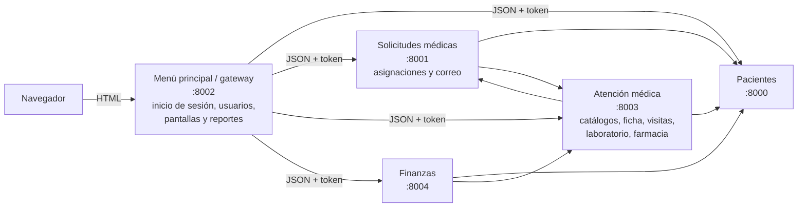

# Sistema de Administración — Asilo de Ancianos Cabeza de Algodón

Sistema para gestionar a los internos del asilo, su atención médica con la fundación
(solicitudes, visitas, laboratorio y farmacia) y las finanzas (cuentas, cobros, cuotas,
donaciones, gastos y pagos a la fundación).

Proyecto final de Análisis y Diseño de Sistemas II — Universidad Mariano Gálvez, sede Mazatenango.

## Arquitectura

El sistema está formado por cinco servicios en **Python con FastAPI**. El usuario solo usa el
**menú principal (gateway)**; este muestra las pantallas y consulta a los demás servicios.



| Carpeta | Contenido |
|---|---|
| `gateway/` | Menú principal: rutas (controladores), plantillas HTML (vistas) y estilos |
| `pacientes/` | Microservicio de pacientes |
| `solicitudes/` | Microservicio de solicitudes, asignación de médico, horario y enfermero, y correo al familiar |
| `medico/` | Microservicio de médicos, especialidades, enfermeros, ficha e historial, visitas, laboratorio y farmacia |
| `finanzas/` | Microservicio de entradas, salidas y caja |
| `comun/` | Código compartido: seguridad y roles, validación, mensajes de error, repositorio de datos, correo |
| `tests/` | Pruebas automáticas basadas en el plan de pruebas SQA |
| `docs/` | Informe de correcciones para SQA y manual de usuario |

Cada servicio separa sus capas: **modelos** (Pydantic, validan los datos), **rutas**
(controladores) y **repositorio** (`comun/repositorio.py`, patrón Repository). Las pantallas
usan plantillas Jinja2, que escapan automáticamente el texto del usuario.

### Datos

> **Pendiente:** los datos se guardan en memoria y se pierden al reiniciar los servicios.
> Todo el acceso a datos pasa por `RepositorioMemoria`; para conectar la base de datos
> (MySQL, SQL Server u Oracle) hay que crear un repositorio con los mismos métodos
> (`listar`, `obtener`, `agregar`, `actualizar`, `eliminar`) y usarlo en lugar del actual.

### Seguridad

- Inicio de sesión en el menú principal; las contraseñas se guardan cifradas (PBKDF2).
- La sesión es un token firmado (cookie `HttpOnly`) que vence en 8 horas.
- **Todos** los servicios exigen el token: sin sesión responden `401` y con un rol sin
  permiso responden `403`. Los permisos por rol están en `comun/seguridad.py`.

## Instalación

Requisitos: Python 3.12 o superior.

```powershell
git clone https://github.com/pablo123-cmd/ASILOCABEZA-DE-ALGODON.git
cd ASILOCABEZA-DE-ALGODON
python -m pip install -r requirements.txt
```

## Ejecución

Desde la carpeta del proyecto:

```powershell
python iniciar.py
```

Esto inicia los cinco servicios. Abra **http://127.0.0.1:8002** en el navegador.
Para detenerlos presione `Ctrl+C`.

También se puede iniciar cada servicio por separado (siempre desde la carpeta raíz):

```powershell
python -m uvicorn pacientes.main:app --port 8000
python -m uvicorn solicitudes.main:app --port 8001
python -m uvicorn gateway.main:app --port 8002
python -m uvicorn medico.main:app --port 8003
python -m uvicorn finanzas.main:app --port 8004
```

La documentación de cada API está en `/docs` de su puerto, por ejemplo
http://127.0.0.1:8000/docs. Para probarla desde ahí, inicie sesión primero en el menú principal
en el mismo navegador.

### Usuarios de prueba

| Usuario | Contraseña | Rol |
|---|---|---|
| `admin` | `Admin2026!` | Administrador (acceso a todo) |
| `personal` | `Asilo2026!` | Personal del asilo |
| `medico` | `Asilo2026!` | Médico general |
| `especialista` | `Asilo2026!` | Médico especialista |
| `enfermero` | `Asilo2026!` | Enfermero(a) |
| `fundacion` | `Asilo2026!` | Fundación |
| `laboratorio` | `Asilo2026!` | Laboratorio |
| `farmacia` | `Asilo2026!` | Farmacia |
| `finanzas` | `Asilo2026!` | Encargado financiero |

### Configuración opcional (variables de entorno)

| Variable | Uso |
|---|---|
| `ASILO_CLAVE_SECRETA` | Clave con la que se firman las sesiones. **Cámbiela en producción**; debe ser la misma en los cinco servicios. |
| `SMTP_HOST`, `SMTP_PUERTO`, `SMTP_USUARIO`, `SMTP_CONTRASENA`, `SMTP_REMITENTE` | Servidor de correo para avisar a los familiares. Sin `SMTP_HOST` los correos se registran como «Simulado» en *Correos a familiares*. |
| `URL_PACIENTES`, `URL_SOLICITUDES`, `URL_MEDICO`, `URL_FINANZAS` | Direcciones de los servicios si no se ejecutan en `127.0.0.1`. |

## Pruebas automáticas

```powershell
python -m pytest
```

Las pruebas siguen los casos del plan de pruebas SQA (CP-01 a CP-49) y no necesitan
que los servicios estén encendidos.
